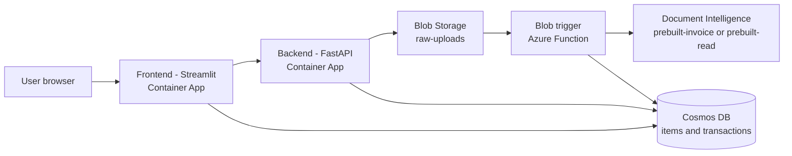

# Smart Storage Manager
Containerized inventory web app. Users upload images, invoices and delivery notes. A blob-triggered Azure Function extracts their text with Azure AI Document Intelligence and stores the results in Cosmos DB.
## Architecture

Supporting services: Azure Container Registry, Log Analytics, Application Insights, Terraform (infra as code).
## Repository layout
| Folder | Content |
|---|---|
| `backend/` | FastAPI API: `/health`, `/upload`, `/items` |
| `frontend/` | Streamlit UI: upload and inventory table |
| `functions/` | Blob-triggered Azure Function (Document Intelligence) |
| `infra/` | Terraform for all Azure resources |
| `docs/` | Proposal and documentation |
## Run locally
1. Create a `.env` file in the repo root with `STORAGE_CONNECTION_STRING`, `COSMOS_ENDPOINT` and `COSMOS_KEY`. The file is git-ignored.
2. Start the containers:
```powershell
docker compose up --build -d
```
3. Open http://localhost:8501
## Deploy to Azure
Target: Azure Container Apps, region `swedencentral`.
```bash
cd infra
terraform init
terraform plan
terraform apply
```
Then build and push the images to Azure Container Registry (ACR Tasks is not available in the student subscription, so images are built locally) and create the two Container Apps. The backend gets the storage and Cosmos settings as secrets; the frontend gets `BACKEND_URL`.
## Monitoring
- Health check: `GET /health` on the backend.
- Container logs: Log Analytics table `ContainerAppConsoleLogs_CL`.
- Function logs: Application Insights (`AppTraces`).
## Load test results
Test: 2000 requests to `GET /items` with 50 parallel clients.
| Run | Replicas | Result | Time |
|---|---|---|---|
| 1 | 1 | 2000 x 200 | 1m 42s |
| 2 | 1 to 3 (autoscaled) | 1993 x 200, 7 x 502 | 1m 48s |
A single request without load takes about 0.17 s. The bottleneck is the cross-partition query on the `items` container, not the number of replicas.
## Known limitations
- `/items` reads the whole container, so latency grows under load. Pagination or a narrower query would fix this.
- Cosmos DB free tier throughput is limited.
- Streamlit frontend logs `RuntimeError` entries from the ASGI layer; the app keeps working.
- Terraform state is kept outside the repo and must not be committed.
- No CI/CD pipeline; deployment is manual.
## Cost and cleanup
Destroy all resources when finished:
```bash
cd infra
terraform destroy
```
